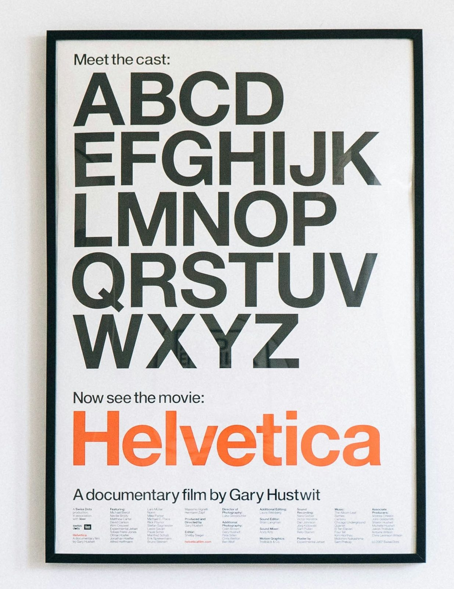

<!-- _class: lead -->


# <!--fit--> NOBEAMER <br> **SWISS**

### *GUIDELINES &* META-SPECIFICATION

- *THEME*: NOBEAMER-SWISS
- *STYLE*: INTERNATIONAL TYPOGRAPHIC
- *VERSION*: 2.0
- *STATUS*: PRODUCTION-READY

---

<!-- _class: cols-2 -->

## Swiss Meta-Guide Syllabus

Overview of the design tokens, layout primitives, and specialized components:

> [01](#card)
> ### Typography & Grid
> Strict baseline alignments, Neo-Grotesque scale, and column-spanning headers.

> [02](#card)
> ### Architecture
> Unified `#card` anatomy, auto-scaling titles, and semantic status blocks.


> [03](#card)
> ### Technical Data & Logic
> Tabular numeric tables, container-scroll code, and formula resolution.

> [04](#card)
> ### Color & Inversion
> Single-property `--accent` customization and high-contrast `invert` mode.

---

<!-- _class: cols-2 -->

## Design Philosophy & Typography

The Swiss Style (International Typographic Style) rejects arbitrary decoration in favor of structural clarity, objective legibility, and geometric order:

- **Asymmetry**: Flush-left, ragged-right typography establishes dynamic balance without optical centering.
- **Extreme Contrast**: Monumental uppercase titles paired with crisp body text and technical monospace.
- **Physical Integration**: Ink-bleed synthesis and multiply blend on warm uncoated paper texture (`nb_img/paper2.jpg`).


### Basic Markdown Hierarchy

```markdown
Normal body text with **bold emphasis** in dark carbon black, 
*italicized nuances*, and `inline code`.

- Unordered list item with Swiss Red bullet
- Second hierarchical item
  - Indented technical sub-item

1. Tabular ordered sequence
2. Monospace-numbered step
```

---

<!-- _class: cols-2 -->

## Heading Hierarchy & Spanning

Live hierarchy rendered on the grid:

# Title (H1) **strong**

## Section (H2) **strong**

### Subsection (H3)

#### Micro-Label (H4)


### Heading Markdown Syntax

```markdown
# Title (Uppercase + Red Accent Block)
## Section (Solid Black Underline)
### Subsection (Uppercase Sub-header)
#### Micro-Label (Uppercase Monospace Tag)
```

> [](#i) **Multi-Column Column Spanning**
> In both `cols-2` and `cols-3`, `h1` and `h2` automatically span across all columns (`column-span: all;`).

---

<!-- _class: cols-2 -->

## Multi-Column Modular Grids

Slide layouts are divided into rational columns using standard classes:

- **Two Columns**: `<!-- _class: cols-2 -->`
- **Three Columns**: `<!-- _class: cols-3 -->`
- **Clean Column Break**: Use `` to force a column break with zero vertical whitespace artifacts.
- **Balanced Gutter**: Set to `48px` on `cols-2` and `36px` on `cols-3` for disciplined rhythmic breathing room.


### Multi-Column Authoring Template

```markdown
<!-- _class: cols-2 -->

## Section Title (Spans All Columns)

Left column markdown content...


Right column markdown content...
```

> [GRID](#card) **No CSS Hacks Needed**
> Native CSS multi-columns keep your markdown pristine and portable.

---

<!-- _class: cols-2 -->

## The Swiss Card (`#card`)

The signature component for definitions, theorems, and core concepts:

> [DEF 01](#card)
> ### <!-- fit --> Grid Topology
> Let $G = (V, E)$ denote an orthogonal modular grid where interval $\delta$ is invariant across subdivisions:
> $$\delta(x, y) = \kappa \cdot \sqrt{\Delta x^2 + \Delta y^2}$$


### Architectural Features

- **Transparent Ground**: No floating SaaS card; paper texture breathes through naturally.
- **Anchor Border**: 5px Swiss Red left rule + 1px hairline perimeter.
- **Right Tag**: Floating uppercase badge (`> [TAG](#card)`).
- **Auto-Scaling Title**: `### <!-- fit --> Title` scales horizontally to fill the gap up to the tag margin.
- **Academic Serif Body**: Justified Literata serif with automatic hyphenation.
- **Centered Math**: Display equations stay centered.

---

<!-- _class: cols-2 -->

## Authoring `#card` Modules

Two supported header patterns for Swiss Cards:

### 1. Dynamic Auto-Scaling (Recommended)

```markdown
> [THEOREM 01](#card)
> ### <!-- fit --> Modular Invariance
> Formal proof body text in academic serif.
> $$\oint_{\Gamma} \vec{F} \cdot d\vec{r} = 0$$
```

The tag paragraph **must precede** the `### <!-- fit -->` heading so the tag floats right and the title fills the remaining gap.


### 2. Static Bold Header (Fallback)

```markdown
> [DEF 02](#card)
> **Coordinate Projection**
> Standard bold heading with an architectural hairline divider underneath.
```

> [](#a) **Authoring Rule**
> Always write the tag anchor as `[TAG](#card)` (or `[TAG](#card-r)` for right alignment) as the first line of the blockquote. If omitted, the card renders without the badge.

---

<!-- _class: cols-2 -->

## Flexible Card Workflows

The unified `#card` primitive flexibly replaces specialized step blocks for sequential workflows, syllabi, and methodology:

> [01](#card)
> ### Rational Layout
> Establish orthogonal baseline and horizontal margin bounds.

> [02](#card)
> ### Typographic Tension
> Set monumental title contrast against high-density data.


### Workflow Syntax

```markdown
> [01](#card)
> ### Step Identifier
> Action description or methodology narrative.
```

- **Unified Primitive**: Eliminates redundant card styles in favor of one robust component.
- **Custom Badges**: Use `[01](#card)`, `[STEP 02](#card)`, or any semantic token.
- **Header Flexibility**: Choose auto-scaling `### <!-- fit -->`, standard `###`, or `**Bold**`.

---

<!-- _class: cols-2 -->

## Semantic Status Cards (`#i`, `#a`, `#s`)

Modular status callouts for architectural and technical feedback:

> [](#i) **Informational Bulletin (`#i`)**
> Neutral notice framed with a 4px solid black top border.

> [](#a) **Critical Constraint (`#a`)**
> High-priority warning with Swiss Red border and tinted ground.

> [](#s) **Empirical Validation (`#s`)**
> Verified result marked with a deep forest green border.


### Alignment Anchors

Append `-l`, `-c`, or `-r` to set card width and alignment:

- **Left (48% width)**: `[](#i)`, `[](#a)`, `[](#s)`, `[TAG](#card-l)`
- **Centered (60% width)**: `[](#i-c)`, `[](#a-c)`, `[](#s-c)`, `[TAG](#card-c)`
- **Right (48% width)**: `[](#i-r)`, `[](#a-r)`, `[](#s-r)`, `[TAG](#card-r)`

```markdown
> [TAG](#card-l)
> ### Left Card (48%)
> Aligned flush-left to the margin datum.

> [TAG](#card-r)
> ### Right Card (48%)
> Aligned flush-right to the margin datum.
```

---

<!-- _class: cols-2 -->

## Bento Dark Module (`#d`)

A high-contrast carbon black module (`#161514`) for primary theorems, core axioms, or dramatic callouts:

> [](#d) **The Axiom of Form & Content**
> *"Design is the method of putting form and content together. Design is so simple, that's why it is so complicated."*
> — Paul Rand
> 
> Inline parameters like `grid_ratio = 1.618` use dark monospace pills, while **bold emphasis** automatically inherits Swiss Red.


### Markdown Syntax

```markdown
> [](#d) **Module Title**
> Body text with high contrast.
> **Bold text** appears in Swiss Red.
> `Inline code` renders in a dark pill.
```

> [TIP](#card) **Contrast Strategy**
> Use at most one `#d` module per slide to maintain visual weight and avoid overpowering the light paper surface.

---

## Data Presentation (Grid Precision)

Tables embody Swiss precision: bold uppercase sans-serif headers, tabular monospace figures in `IBM Plex Mono`, and alternating row shading:

| Benchmark Identifier | Sample Size ($N$) | Latency (ms) | Efficiency Ratio | Status |
| :--- | :--- | :--- | :--- | :--- |
| **MODULAR-GRID-A** | $12,500$ | $1.42 \pm 0.04$ | $0.984$ | **VERIFIED** |
| **ASYM-HIERARCHY-B** | $28,400$ | $2.15 \pm 0.08$ | $0.961$ | **VERIFIED** |
| **GROTESQUE-TYPE-C** | $45,000$ | $0.88 \pm 0.02$ | $0.997$ | **OPTIMAL** |

```markdown
| Parameter | Value | Status |
| :--- | ---: | :--- |
| **Sample A** | $1,250$ | **VERIFIED** |
```

---

<!-- _class: cols-2 -->

## Code Presentation & Architecture

- **Clean Monospace**: High-legibility `IBM Plex Mono` with zero skeuomorphic scanlines or glow.
- **Structural Left Rule**: 4px black accent rule with a top-right `CODE` metadata indicator.
- **Scrollable Containers**: Wrap long code in `<div class="code-scroll">` for uncompressed scrolling.

<div class="code-scroll">

```python
# Swiss Layout Computation Engine
def calculate_modular_bounds(canvas_w: int = 1920, cols: int = 12) -> dict:
    """Calculates column widths adhering to Swiss grid discipline."""
    margin_x = 56
    gutter = 48
    usable = canvas_w - (2 * margin_x)
    col_w = (usable - (cols - 1) * gutter) / cols
    return {"col_width": round(col_w, 2), "gutter": gutter}
```

</div>


### Scrollable Code Syntax

```html
<div class="code-scroll">

```python
# Long source code here...
# Wrapped with sticky Swiss Red header bar
```

</div>
```

> [](#i) **Automatic Line Wrapping**
> Uses CSS Container Queries (`cqw`) to wrap lines without distorting the font scale or causing unwanted horizontal clipping.

---

## Mathematical Formulas & Proofs

For dedicated mathematical deductions and prominent formal equations, wrap display math inside `<div class="math-resolution">`:

<div class="math-resolution">

$$
\mathcal{L}_{\text{swiss}}(\theta) = \sum_{k=1}^K \left[ \alpha \cdot \log \left( 1 + \frac{\text{Contrast}(k)}{\text{Noise}(k)} \right) - \beta \cdot \|\nabla_{\text{grid}} \Phi(k)\|_2^2 \right]
$$

</div>

```html
<div class="math-resolution">

$$
\mathcal{L}_{\text{swiss}}(\theta) = \sum_{k=1}^K \left[ \dots \right]
$$

</div>
```

Framed in a sharp 2px black container with the technical indicator `FORMULA // RESOLUTION` pinned to the upper-right corner.

---

<!-- _class: cols-2 -->

## Universal Metrics & 'stat' Slides

### 1. Inline Metric Callout

<div style="padding-top: 10px;">
  <div class="metric">99.4%</div>
  <div class="metric-label">READABILITY INDEX</div>
  <p style="margin-top: 12px; font-size: 0.92rem; color: #555;">
    Monumental Geist Black numbers for quantitative impact inside standard slides.
  </p>
</div>

```html
<div class="metric">99.4%</div>
<div class="metric-label">INDEX</div>
```


### 2. Standalone Stat Slide (`class: stat`)

For keynote transitions centered entirely around a single massive figure:

```markdown
<!-- _class: stat -->

<div class="metric">4.2×</div>
<div class="metric-label">THROUGHPUT RATIO</div>

Quantitative benchmark outcome across full deployment clusters.
```

The `stat` class expands the metric font size to **130px** for dramatic stage visibility.

---

<!-- _class: cols-2 -->

## Objective Imagery Guidelines

In Swiss Modernism, imagery is documentation, not ornament. All rounded corners and drop shadows are strictly prohibited (`border-radius: 0; box-shadow: none;`):

<figure>
  
  <figcaption>FIG. 01 / HELVETICA SPECIMEN & MODULAR SPATIAL EQUILIBRIUM</figcaption>
</figure>


### Technical Captions & Specs

```html
<figure>
  
  <figcaption>FIG. 01 / TECHNICAL CAPTION</figcaption>
</figure>
```

Use `<div class="callout-specs">` for technical metadata:

<div class="callout-specs">
ASPECT: 16:9 RATIO<br>
GRID: 12-UNIT ORTHOGONAL MODULE<br>
GRAIN: UNCOATED COTTON FIBER
</div>

---

<!-- _class: cols-2 -->
<!-- _style: "--accent: #0066CC;" -->

## Theme Parameterization (`--accent`)

The entire theme color identity is parameterized by a single CSS custom property `--accent` (default Swiss Red `#E30613`):

- **Global Override (Frontmatter)**:
  ```yaml
  style: ":root { --accent: #0066CC; }"
  ```
- **Per-Slide Override (Slide Directive)**:
  ```markdown
  <!-- _style: "--accent: #0066CC;" -->
  ```

Zero utility classes required. All primary highlights inherit `--accent` dynamically.


### Live Accent Override Demo

This slide executes `<!-- _style: "--accent: #0066CC;" -->`:

> [](#a) **Dynamic Inheritance**
> Alert borders, headline bold color, list bullets, and card indicators immediately adapt to `#0066CC`.

<div class="callout-specs">
VARIABLE: --accent<br>
CURRENT VALUE: #0066CC<br>
STATUS: ACTIVE OVERRIDE
</div>

---

<!-- _class: invert cols-2 -->

## Inverted Contrast Mode (`invert`)

### High-Contrast Editorial Authority

The `invert` class provides an uncompromising deep black (`#161514`) environment engineered for keynote openers, section dividers, or evening defenses:

- **Typography**: Seamlessly flips to crisp white with Swiss Red accents.
- **Tables & Code**: Borders adjust to subtle dark hairlines without manual class overrides.


> [](#d) **Core Tenet of Swiss Modernism**
> *"Order in design is not the absence of chaos, but the mastery of structural relationships."*
> — Josef Müller-Brockmann

```markdown
<!-- _class: invert cols-2 -->

## Inverted Section Title

Inverted slide content...
```

---

<!-- _class: cols-2 -->

## Quick Authoring Reference

Key conventions to keep in mind when authoring in `nobeamer-swiss`:

| Objective | Syntax / Directive |
| :--- | :--- |
| **Title Slide** | `<!-- _class: lead -->` with `![bg right:46% ...]` |
| **2-Column Layout** | `<!-- _class: cols-2 -->` + `` |
| **3-Column Layout** | `<!-- _class: cols-3 -->` + `` |
| **Swiss Card** | `> [TAG](#card)` + `### <!-- fit --> Title` |
| **Right Card** | `> [TAG](#card-r)` + `### Title` |
| **Dark Module** | `> [](#d) **Title**` |
| **Workflow Card** | `> [01](#card)` + `### Title` |


### Strict Design Guidelines

- **No decorative icons or emojis**: Swiss modernism relies strictly on typography and numerical identifiers (`01 / STEP`, `[DEF]`).
- **No rounded corners or drop shadows**: Flat geometry respects the physical sheet with zero skeuomorphism.
- **No centered body text**: Maintain disciplined flush-left, ragged-right rhythm for maximum legibility.
- **Controlled bold emphasis**: Contrast relies on monumental scale differential rather than pervasive bolding.

