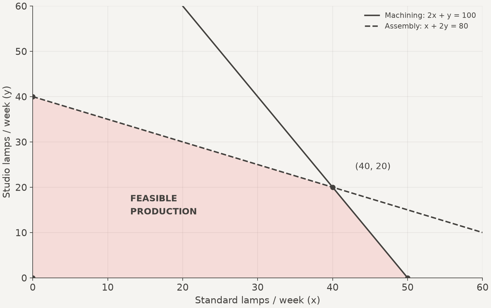
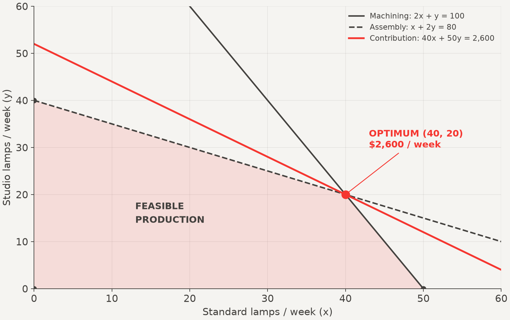

<!-- All business data are hypothetical. Calculations and figures are reproducible with:
     uv run lab/production_planning.py
     Monetary amounts are USD; production quantities and capacities are weekly. -->

<!-- _class: lead -->

<!-- Cover photograph: Steffen Petermann / Unsplash.
     https://unsplash.com/photos/a-black-lamp-on-a-white-table-next-to-a-green-wall-cGcFrQTQ3Jo -->

# <!--fit--> PRODUCTION   **PLANNING**

### *A linear programming case study*

- **Context**: A lighting workshop
- **Decision**: The weekly product mix
- **Method**: Model → geometry → recommendation

---

<!-- _class: editorial cols-2-a -->
<!-- _header: "PRODUCTION PLANNING / THE BRIEF" -->
<!-- _footer: "Contribution = sales revenue minus variable costs. Fixed costs are excluded." -->

# The **decision.**

A workshop makes **Standard** and **Studio** lamps using shared machining and assembly time.

### One weekly plan

Choose the product mix with the highest contribution within the available hours.

### Production data

<!-- math-verified: machining coefficients=[2,1], capacity=100; assembly coefficients=[1,2], capacity=80; contribution coefficients=[40,50] USD/unit; verified by lab/production_planning.py -->

| Per lamp | Standard | Studio |
| :--- | ---: | ---: |
| Machining (h) | 2 | 1 |
| Assembly (h) | 1 | 2 |
| Contribution (USD) | 40 | 50 |

> [Weekly capacity](#metrics)
> - **100** *h*
>   - Machining
> - **80** *h*
>   - Assembly

---

<!-- _class: cols-2 -->

## Define the **Variables**

> [MODEL](#card)
> ### The quantities we control
> Let $x$ be Standard lamps produced per week.
>
> Let $y$ be Studio lamps produced per week.

A production plan is a point $(x, y)$.

### Assumptions

- All lamps produced can be sold.
- Time per lamp and unit contribution stay constant.
- Only machining and assembly limit production.
- Quantities are continuous in the model.

The final plan must also use whole lamps. Here, the continuous optimum is already integral.

---

<!-- _class: cols-2 -->

## Write the **Model**

<!-- math-verified: maximize Z=40x+50y subject to 2x+y<=100, x+2y<=80, x>=0, y>=0; optimum=(40,20), Z=2600; verified by lab/production_planning.py -->

$$
\begin{aligned}
\max\quad & Z = 40x + 50y \\
\text{subject to}\quad & 2x + y \le 100 \\
& x + 2y \le 80 \\
& x, y \ge 0
\end{aligned}
$$

### Read Each Line

**Objective** — maximize weekly contribution in USD.

**Machining** — total hours used cannot exceed capacity.

**Assembly** — the same capacity rule applies.

**Nonnegativity** — negative production is impossible.

---

<!-- _class: cols-2-a -->

## Map the **Feasible Region**

> [GEOMETRY](#card)
> ### Feasible means possible
> A plan is feasible only if it satisfies every constraint at the same time.

The shaded polygon contains all feasible plans.

Each boundary marks a resource limit or zero production.

*FIG. A / Both capacity inequalities must hold; boundary points are included.*

---

<!-- _class: cols-2-a -->

## Compare the **Corners**

A linear objective over this bounded feasible polygon reaches an optimum at a corner.

Evaluate the same objective at every corner.

The best feasible value determines the plan.

<!-- math-verified: vertices=[(0,0),(50,0),(40,20),(0,40)]; Z=[0,2000,2600,2000]; maximum=2600; improvement over either single-product plan=600; verified by lab/production_planning.py -->

| Standard ($x$) | Studio ($y$) | Contribution (USD) |
| ---: | ---: | ---: |
| 0 | 0 | 0 |
| 50 | 0 | 2,000 |
| **40** | **20** | **2,600** |
| 0 | 40 | 2,000 |

Studio has the higher unit contribution. Producing only Studio lamps still earns less than the mixed plan.

---

<!-- _class: cols-2 -->

## Find the **Intersection**

At the winning corner, both resource constraints are equalities.

<!-- math-verified: 2x+y=100 and x+2y=80 imply 3x=120, x=40, y=20; verified by lab/production_planning.py -->

$$
\begin{aligned}
2x+y &= 100 \\
x+2y &= 80 \\
2(2x+y)-(x+2y) & = 200-80 \\
3x &= 120 \\
x &= 40,\qquad y=20
\end{aligned}
$$

> [METHOD](#card)
> ### Eliminate a variable
> Double the machining equation, then subtract the assembly equation. The Studio term cancels.

Substitute $x$ back into either equation to find $y$.

This identifies a candidate. The corner comparison establishes that it is optimal.

---

<!-- _class: cols-2-a -->

## See the **Optimum**

Each objective line represents plans with the same contribution.

Move the line outward, parallel to itself, to increase contribution.

The last feasible contact occurs where the resource boundaries meet.

<!-- math-verified: objective line 40x+50y=2600 passes through (40,20); feasible maximum=2600; verified by lab/production_planning.py -->

*FIG. B / The red objective line touches the feasible region at its optimal corner.*

---

## Audit the **Plan**

Check each resource before making the recommendation.

<!-- math-verified: plan=(40,20); machining=2*40+20=100, slack=0; assembly=40+2*20=80, slack=0; contribution=40*40+50*20=1600+1000=2600; total units=60; verified by lab/production_planning.py -->

| Resource | Hours used | Hours available | Hours unused |
| :--- | ---: | ---: | ---: |
| Machining | 100 | 100 | 0 |
| Assembly | 80 | 80 | 0 |

$$
Z = 40(40) + 50(20) = 1{,}600 + 1{,}000 = \mathbf{2{,}600}
$$

Both resources are fully used. The plan produces **60 lamps** with no capacity violation.

---

<!-- _class: accent cols-2 -->

## The **Recommendation**

<!-- math-verified: Standard=40 units/week; Studio=20 units/week; contribution=2600 USD/week; advantage over either single-product plan=600 USD/week; verified by lab/production_planning.py -->

### Produce the Mix

**40 Standard lamps** per week.

**20 Studio lamps** per week.

**\$2,600** weekly contribution.

### Why This Plan Wins

It earns **\$600 more** than either single-product plan.

The products use the constrained resources in different proportions.

A higher contribution per unit alone does not identify the best mix.

---

<!-- _class: cols-2 -->

## What If Capacity **Changes**?

<!-- math-verified: machining capacity=106, assembly capacity=80; new optimum=(44,18), contribution=2660; deltas=(4,-2), contribution gain=60; verified by lab/production_planning.py -->

The workshop can add **6 machining hours** next week. Assembly capacity stays unchanged.

> [EXERCISE](#card)
> ### Revisit the model
> Update the machining constraint, locate the new intersection, and compare weekly contribution.

### Questions

- Does the original mix remain feasible?
- What is the new optimal mix?
- How much additional contribution is possible?
- Would adding machining time justify its cost?

Treat the extra hours as optional. Their cost is not yet included in the objective.

---

<!-- _class: cols-2 -->

## Check the **Answer**

<!-- math-verified: 2x+y=106 and x+2y=80 yield x=44,y=18; resource usage=[106,80]; contribution=40*44+50*18=2660; gain=2660-2600=60; original plan remains feasible; verified by lab/production_planning.py -->

$$
\begin{aligned}
2x+y &= 106 \\
x+2y &= 80 \\
x &= 44,\qquad y=18 \\
Z &= 40(44)+50(18) \\
&=2{,}660
\end{aligned}
$$

The original plan remains feasible; the new mix earns **\$60 more**.

### From Model to Decision

**Feasibility** — respect every resource limit.

**Optimality** — compare feasible alternatives using the objective.

**Interpretation** — convert the solution into a production plan.

For this capacity change, pay **less than \$60 in total** for the extra hours to increase net contribution. At \$60, the gain is exactly offset.
